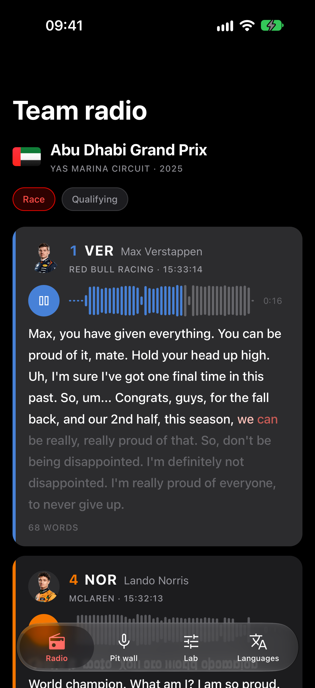
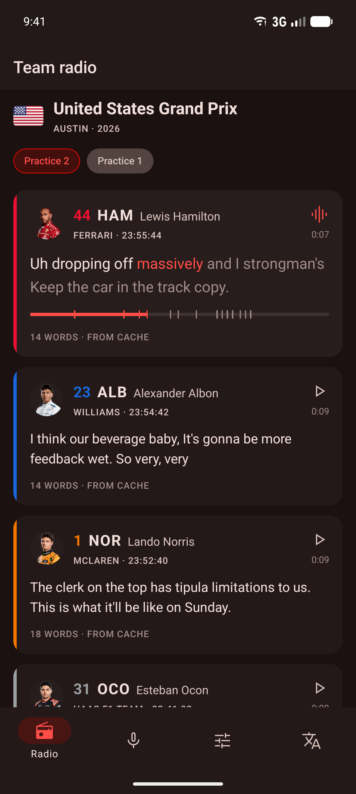

# expo-speech

[](https://www.npmjs.com/package/@hzblj/expo-speech)
[](./LICENSE)

Speech to text for Expo on the platforms' own Speech APIs, on the device: `SpeechAnalyzer` on iOS 26 (`SFSpeechRecognizer` before it) and the on-device `SpeechRecognizer` on Android. Files and the microphone, a time for every word, a transcription queue with a cache, and highlighting while the audio plays.

<p>
  
  
</p>

```sh
npx expo install @hzblj/expo-speech
```

```tsx
import {SpeechTranscriber, TranscriptText, useTranscriptPlayback} from '@hzblj/expo-speech'

const transcriber = new SpeechTranscriber({locale: 'en-GB'})
const transcript = await transcriber.transcribe('https://example.com/radio.mp3', {cacheKey: 'radio'}).wait()

// In a component, with an expo-audio player: the word being said, on time.
const {wordIndex} = useTranscriptPlayback(transcript, player)
<TranscriptText transcript={transcript} wordIndex={wordIndex} activeWordStyle={{color: '#e10600'}} />
```

**[Documentation](./packages/expo-speech/README.md)**: files, the microphone, playback, the queue and the cache, every option, languages and models, and how the platforms differ.

## This repository

| Path | What lives there |
| --- | --- |
| `packages/expo-speech/` | `@hzblj/expo-speech`, the published package: the JavaScript API and hooks, the iOS and Android module, and the config plugin |
| `apps/example/` | The example app, built from [Kara](https://github.com/hzblj/kara-ui): a Formula 1 weekend's team radio (captured from [OpenF1](https://openf1.org)), transcribed on the device and played back with its words lit; the pit wall's own radio through the microphone; a lab with every option; the languages and their models |

```sh
yarn                 # install
yarn prebuild        # a clean `expo prebuild` of the example
yarn ios             # run the example on iOS (dev client); `yarn android` for Android
yarn start           # Metro for the example
yarn test            # the JavaScript and config plugin tests
yarn test:ios        # the Swift tests on the Mac, against real speech
yarn test:android    # the Kotlin tests on the JVM (after a prebuild)
yarn lint            # Biome and TypeScript
yarn pack:check      # pack the package as npm gets it and type-check a consumer
yarn changeset       # describe a change for the next release
```

## More libraries

The other libraries from the same author are at **[libraries.janblazej.dev](https://www.libraries.janblazej.dev)**.

## Sponsorship

<a href="https://www.buymeacoffee.com/hzblj"></a>

## License

MIT © Jan Blazej. The example holds the weekend's names, times and links; the audio and photos stream from Formula 1 while it runs, and none of them are part of this repository.
